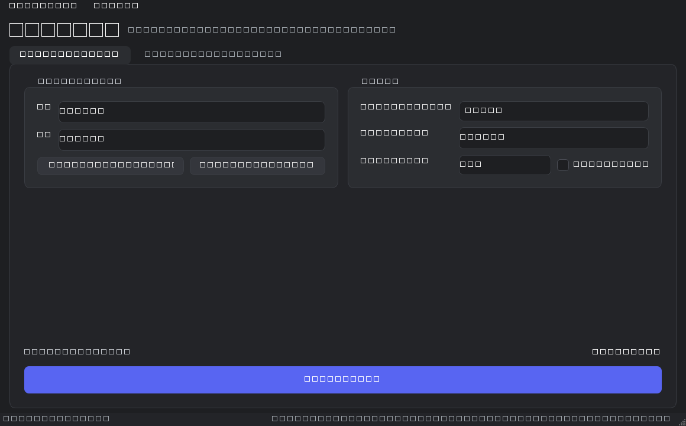
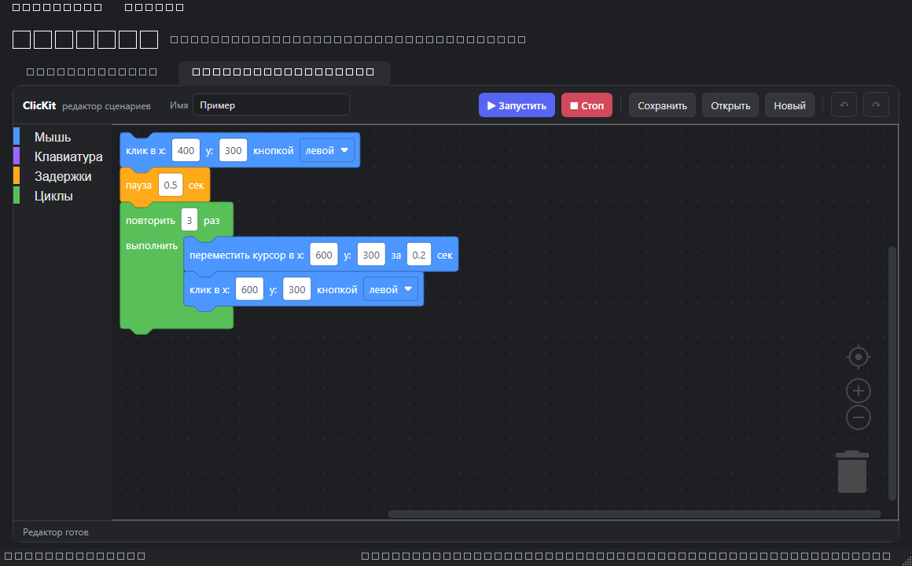
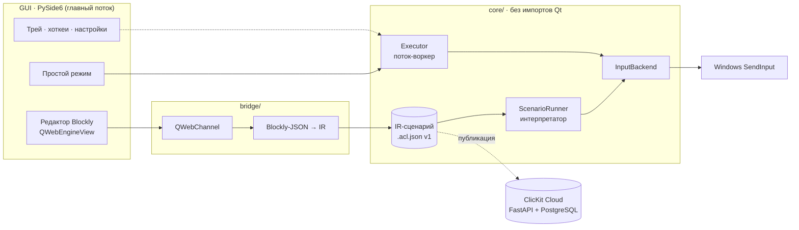

<div align="center">


# 🧰 ClicKit

**The auto-clicker that builds like a kit.**

A Windows auto-clicker with visual block scripting: snap colorful blocks
together to script clicks, moves and delays — no coding required.

[](https://github.com/AkaDaka1/ClicKit/actions/workflows/ci.yml)
[](https://github.com/AkaDaka1/ClicKit/releases)
[](LICENSE)
[](https://www.python.org)
[](https://github.com/astral-sh/ruff)
[](https://www.microsoft.com/windows)
[](https://doc.qt.io/qtforpython/)
[](https://developers.google.com/blockly)
[](docs/api.md)
[](https://github.com/AkaDaka1/ClicKit/pkgs/container/clikit-test)
[](#contributing--security)

**English** · [Русский](#ru)

</div>

## 📸 Screenshots

<p align="center">
  
  
</p>

<p align="center">
  <sub>Simple mode (left) and the block scenario editor with the starter click scenario (right), dark theme.</sub>
</p>

## 🏗️ Architecture at a glance


Four invariants keep the layers honest:

- **Scenarios are data, never code.** Blockly builds a versioned IR
  (`.acl.json`); the interpreter executes only the known node types.
- **`core/` never imports Qt.** The engine is testable headless, and the GUI
  talks to it through adapters and signals.
- **Scripts run in a worker thread.** The GUI thread never blocks, and the
  emergency stop hotkey stays responsive.
- **One cursor, one owner.** Clicks and scenarios are mutually exclusive,
  because both drive the single Windows pointer (see
  [`AI_CONTEXT.md` §3.1](AI_CONTEXT.md)).

---

<a id="en"></a>

## 🚧 Project status

**ClicKit 1.0.0** — the first public release. Milestones **M0–M6** are complete
and merged into `master`; **M7** (ClicKit Cloud: scenario API, PostgreSQL,
container image, local compose) is in progress, while **M8–M11** (observability,
IaC, delivery, security/resilience) are planned and tracked in
[`plans/README.md`](plans/README.md). The app follows the Windows theme by default
(system / dark / light can be picked in Settings), all three global hotkeys
(start, stop, coordinate picker) are configurable without a restart, and a
rotated log is written to `%APPDATA%\ClicKit\logs\app.log`. Two modes are
available: the classic **Simple mode** and the **block scenario editor** with
live execution highlighting. The release is a portable folder archive
`ClicKit-win64.zip` built with PyInstaller (a single-file `ClicKit.exe` can be
built locally with `--onefile`), so no Python installation is required. Conditions
(`if`/`while`) and the input recorder remain on the roadmap.

## 💡 Why ClicKit?

Regular auto-clickers can only spam one spot on the screen. Advanced macro
tools can do much more, but their interfaces overwhelm people who simply
want to automate a few clicks.

**ClicKit sits in the sweet spot between the two:**

| Mode | Who it is for |
|---|---|
| 🖱️ **Simple mode** | A classic auto-clicker: pick a spot on screen, set interval, mouse button and repeat count — done. |
| 🧩 **Scenario mode** | A visual editor based on Blockly: build complex sequences from drag-and-drop blocks — clicks, moves, delays, loops, conditions — like snapping LEGO bricks. |

## ✨ Key features

- ✅ 🎯 **Coordinate picker** — hover the mouse and press the picker hotkey (`F8` by default) to capture the point;
- ✅ ⛑️ **Global emergency stop** (`F6` by default) — works from any application, even if a script is stuck in a loop;
- ✅ ⌨️ **Configurable hotkeys** — start, stop and picker keys can be re-recorded in Settings and apply instantly;
- ✅ 🧩 **Block editor** with a friendly Russian palette — scenarios are assembled visually, no text code (conditions are planned for a later release);
- ✅ 💾 **Scenarios as safe data files** (`.acl.json`) — validated, versioned internal format (IR); no arbitrary code is ever executed;
- ✅ ▶️ **Live execution highlighting** — the editor shows which block is running right now;
- ✅ 🌗 **System, dark and light themes** — GUI and Blockly switch together, following Windows in system mode;
- ✅ 🪵 **Logs and clear errors** — rotated UTF-8 log in `%APPDATA%\ClicKit\logs`, friendly crash dialog;
- ✅ 📦 **Two release builds** — a fast portable folder (`ClicKit-win64.zip`) and a single-file `.exe` for when one file matters; neither needs Python installed.

## 🗺️ Roadmap

| Milestone | Goal | Status |
|---|---|---|
| **M0** | Repository skeleton: structure, dependencies, app entry point | ✅ Done |
| **M1** | Click engine (core): input backends, global hotkeys, executor — no GUI | ✅ Done |
| **M2** | Main window + Simple mode (MVP auto-clicker) | ✅ Done |
| **M3** | Scenario model (IR): schema, interpreter, save / load | ✅ Done |
| **M4** | Blockly visual editor with live execution | ✅ Done |
| **M5** | Polish: themes, settings, logs, tests, `.exe` packaging | ✅ Done |
| **M6** | DevOps: Docker test/build images, GHCR, dev releases | ✅ Done |
| **M7** | ClicKit Cloud: scenario API, PostgreSQL, Docker | 🚧 In progress |
| **M8** | Observability: metrics, logs, traces, dashboards, SLO | 📋 Planned |
| **M9** | Infrastructure as code: Terraform, k3s, Helm, HTTPS | 📋 Planned |
| **M10** | Continuous delivery: staging/prod, rollback, DORA | 📋 Planned |
| **M11** | Security & resilience: scanning, load, backups, chaos | 📋 Planned |

Details: [`ROADMAP.md`](ROADMAP.md). Plans and task graphs:
[`plans/README.md`](plans/README.md).

## 🚀 Getting started

**Release builds** (Windows 10/11, no Python needed) —
[download from GitHub Releases](https://github.com/AkaDaka1/ClicKit/releases):

- `ClicKit-win64.zip` — **recommended**: unpack the folder and run
  `ClicKit\ClicKit.exe`; starts in a couple of seconds.

Prefer a single file? Build the portable `ClicKit.exe` locally with
`python scripts/build_exe.py --onefile` — QtWebEngine (~220 MB) unpacks itself
on every launch, so the window may take up to a minute to appear.

Keep `NOTICE.txt` next to the executable; `SHA256SUMS.txt` lets you verify the
downloads. Settings and logs live in `%APPDATA%\ClicKit`. The builds are
unsigned, so Windows SmartScreen may ask for confirmation on first launch.

**Run from source:**

```bash
git clone https://github.com/AkaDaka1/ClicKit.git
cd ClicKit
pip install -r requirements.txt
python -m app
```

**Build the release artifacts:**

```bash
pip install -r requirements-build.txt
python scripts/build_exe.py --both   # zip + single .exe
```

Results: `dist/ClicKit-win64.zip` (folder build, fast start),
`dist/ClicKit.exe` (single file), `dist/SHA256SUMS.txt` and `NOTICE.txt`
beside/in the build. `--zip` builds only the folder archive, `--onefile` only
the single file. The `resources/` tree — including the vendored Blockly — is
packed into both.

**Simple mode in four steps:**

1. Set the click point: type X/Y, or hover the cursor over the target and press
   `F8` (the "Current position" button captures it instantly).
2. Pick the mouse button, the interval in milliseconds and the number of
   repeats — or tick "Infinite".
3. Press **Start** or `F5`. Stop at any time with `F6` — it works from any
   application, even when ClicKit is hidden in the tray.
4. Closing the window asks whether to minimize to tray or exit; tick
   "Remember my choice" to skip the question for that case next time.

Settings (theme, global hotkeys, click parameters) live in
`%APPDATA%\ClicKit\settings.json`; **Settings → Parameters…** (`Ctrl+,`) changes
the theme and hotkeys without a restart. Logs are in
`%APPDATA%\ClicKit\logs\app.log` (**Help → Open log folder**). Moving the cursor
to a screen corner also triggers the pyautogui fail-safe stop.

**Scenario editor (M4):**

1. Open the **Scenario editor** tab. The starter scenario shows the idea:
   click → pause → repeat 3×(move + click).
2. Drag blocks from the palette (Mouse, Keyboard, Delays, Loops) and type
   coordinates and durations directly in the blocks.
3. Press **Run** or `F5`: on the editor tab `F5` runs the scenario, on Simple
   mode it starts clicks. `F6` stops either one from any application.
4. The running block is highlighted. Invalid blocks (for example, an empty
   loop) get a warning and the scenario is not executed. `Ctrl+S` / `Ctrl+O`
   save and open `.acl.json`; undo/redo live in the toolbar.

Saved files stay regular IR scenarios (usable by `scripts/run_scenario.py`)
and additionally keep the canvas state in `editor.workspace`. Blockly is
vendored locally, so the editor works without internet access.

**Click engine demo (M1, console):**

```bash
python scripts/demo_click.py --x 1000 --y 500 --count 100 --interval 0.1
```

`F5` starts clicking, `F6` stops instantly from any application, `Esc` exits.

**Scenario runner (M3, console):**

```bash
python scripts/run_scenario.py resources/examples/click_pause_loop.acl.json
python scripts/run_scenario.py my-scenario.acl.json --dry-run
```

`F6` stops, `Esc` exits. `--dry-run` validates the scenario and prints the
action count without touching the mouse. Scenario files use the versioned,
validated ClicKit IR format (`.acl.json`); node types: `click`, `double_click`,
`move`, `drag`, `delay`, `key`, `scroll`, `loop`, `sequence`.

**Requirements:** Windows 10/11. The release `.exe` needs no Python; running
from source or building requires Python 3.11+.

## 🔄 CI/CD

Every pull request and every push to `master` runs
[GitHub Actions](https://github.com/AkaDaka1/ClicKit/actions/workflows/ci.yml)
on `windows-latest`:

- `ruff check .` and `ruff format --check .`;
- `pytest` on Python **3.11, 3.12 and 3.13** (offscreen Qt, WebEngine without
  sandbox and GPU);
- on `master` and on manual runs — a full PyInstaller build of
  `ClicKit-win64.zip`, archive/checksum checks and an offscreen smoke launch of
  the built `.exe`.

Releases are automatic: push a `v<version>` tag that matches `APP_VERSION` in
`app/version.py`, and
[`release.yml`](https://github.com/AkaDaka1/ClicKit/actions/workflows/release.yml)
re-runs the CI, builds the archive, verifies it and publishes a GitHub Release
with `ClicKit-win64.zip`, `NOTICE.txt` and `SHA256SUMS.txt`; release notes come
from `CHANGELOG.md`. Tags with a suffix (`v1.1.0-rc.1`) become pre-releases.
The same checks locally:

```bash
ruff check . && ruff format --check . && python -m pytest
python scripts/build_exe.py --zip
python scripts/verify_release.py --tag v1.0.0 --smoke
```

### DevOps / Docker (M6)

The repository also contains reproducible development infrastructure:

- `docker compose run --rm test` runs the complete Qt/WebEngine test suite in
  a Linux/Xvfb container; the Windows test matrix remains the platform gate;
- `docker/Dockerfile.build-win` pins the Windows Server Core + Python 3.11
  build environment and produces the portable archive with `--zip`;
- `Docker images` publishes `ghcr.io/akadaka1/clikit-test` and
  `ghcr.io/akadaka1/clikit-build-win` on pushes to `master` (`<sha>` and
  `latest`) or `dev` (`<sha>` and `dev`);
- `Release` builds the tagged archive inside the Windows build container;
- `Dev release` can be started manually for any ref (or on `dev`) and updates
  the rolling draft GitHub Release `dev` with `--clobber`.

The Windows-container jobs are intentionally separate from Linux test jobs:
the application itself remains Windows-only, while Linux containers provide a
fast, reproducible test environment.

### ClicKit Cloud (M7, in progress)

- `docker-compose.cloud.yml` starts the FastAPI service, PostgreSQL 16 and a
  one-shot Alembic migration job (API + database + named volume);
- copy `.env.example` to `.env`, set `CLICKIT_API_KEY` and `POSTGRES_PASSWORD`,
  then run `docker compose -f docker-compose.cloud.yml up -d`;
- API contract, configuration and error codes: [`docs/api.md`](docs/api.md).

## 🗂️ Repository map

```text
app/          entry point, logging setup, version, resource paths
core/         click engine, IR schema/interpreter, settings, hotkeys — no Qt
gui/          PySide6 window, simple mode, Blockly editor, themes, tray
bridge/       Blockly-JSON ↔ IR translation and the QWebChannel bridge
resources/    vendored Blockly, QSS themes, icons, example scenarios
service/      ClicKit Cloud: FastAPI app, SQLAlchemy models, Alembic migrations
cloud/        httpx client for the service (M7)
packaging/    PyInstaller spec, Windows version info, NOTICE
docker/       test, Windows build and service images
scripts/      demos, scenario runner, vendoring, release checks, screenshots
tests/        pytest: engine, GUI smoke tests, service, release tools
plans/        milestone plans with task graphs (M0–M11)
docs/         API contract, cloud notes and README screenshots
```

## 🛠️ Tech stack

Python 3.11+ · PySide6 (Qt for Python, LGPL) · Blockly (vendored, Apache-2.0)
inside `QWebEngineView` · `QWebChannel` JS↔Python bridge · `pyautogui` + `pynput`
behind a pluggable `InputBackend` abstraction · PyInstaller for packaging ·
FastAPI + PostgreSQL + SQLAlchemy/Alembic for ClicKit Cloud.

- Architecture and coding rules: [`AI_CONTEXT.md`](AI_CONTEXT.md)
- Work log: [`PROGRESS.md`](PROGRESS.md)
- Milestone plans and task graphs: [`plans/README.md`](plans/README.md)
- Changelog: [`CHANGELOG.md`](CHANGELOG.md)
- API contract for ClicKit Cloud: [`docs/api.md`](docs/api.md)

## 🤝 Contributing & security

Contributions are welcome! Please read [`CONTRIBUTING.md`](CONTRIBUTING.md)
before opening a pull request: it covers the branch/commit conventions, local
checks (`ruff`, `pytest`) and the documentation rule. By participating you agree
to the [`CODE_OF_CONDUCT.md`](CODE_OF_CONDUCT.md).

Found a security issue? **Do not open a public issue** — use the private
reporting channel described in [`SECURITY.md`](SECURITY.md).

## ⚠️ Disclaimer

ClicKit is intended for offline and non-commercial use: automating routine
tasks, testing your own software, single-player games. Using auto-clickers in
online games with anti-cheat protection may violate their terms of service —
you alone are responsible for how you use this tool.

## 📄 License

Released under the [MIT License](LICENSE) © 2026 Danil Momot. Third-party
components keep their own licenses: PySide6 — LGPL v3, Blockly — Apache-2.0.

---

<a id="ru"></a>

<div align="center">

# 🧰 ClicKit (Русский)

**Автокликер, который собирается как конструктор.**

Автокликер для Windows с визуальным блочным программированием: соединяйте
цветные блоки, чтобы собрать сценарий кликов, перемещений и задержек —
без единой строчки кода.

[English](#en) · **Русский**

</div>

## 🚧 Статус проекта

**ClicKit 1.0.0** — первый публичный релиз. Вехи **M0–M6** завершены и влиты
в `master`; **M7** (ClicKit Cloud: API сценариев, PostgreSQL, контейнерный
образ, локальный compose) в работе, а **M8–M11** (наблюдаемость, IaC,
доставка, безопасность и устойчивость) запланированы и ведутся в
[`plans/README.md`](plans/README.md). По умолчанию приложение следует теме Windows (в настройках можно
выбрать «Системная», «Тёмная» или «Светлая»), все три глобальных хоткея
(старт, стоп, захват точки) переназначаются без перезапуска, а журнал
с ротацией пишется в `%APPDATA%\ClicKit\logs\app.log`. Доступны два режима:
классический **«Простой режим»** и **блочный редактор сценариев** с подсветкой
выполнения. Релиз — это архив `ClicKit-win64.zip` (PyInstaller onedir); один
файл `ClicKit.exe` собирается отдельно (`--onefile`), — Python на целевой
машине в обоих случаях не нужен. Условия (`if`/`while`) и запись действий
остаются в планах.

## 💡 Почему ClicKit?

Обычные автокликеры умеют лишь спамить кликами в одной точке экрана.
Продвинутые макрос-инструменты способны на большее, но их интерфейсы
пугают тех, кому нужно просто автоматизировать пару кликов.

**ClicKit — золотая середина:**

| Режим | Для кого |
|---|---|
| 🖱️ **Простой режим** | Классический автокликер: выбрал точку на экране, задал интервал, кнопку мыши и число повторов — готово. |
| 🧩 **Режим сценариев** | Визуальный редактор на базе Blockly: сложные последовательности собираются перетаскиванием блоков — клики, движения, задержки, циклы, условия — как детали LEGO. |

## 🏗️ Архитектура



Четыре инварианта, которые держат слои честными:

- **Сценарий — это данные, а не код.** Blockly собирает версионируемый IR
  (`.acl.json`), интерпретатор исполняет только известные типы узлов.
- **`core/` не импортирует Qt.** Движок тестируется без экрана, а GUI
  общается с ним через адаптеры и сигналы.
- **Сценарии исполняются в воркере.** Главный поток не блокируется, поэтому
  аварийный стоп по хоткею срабатывает всегда.
- **Один курсор — один владелец.** Клики и сценарий взаимоисключающие: оба
  двигают единственный указатель Windows (см. [`AI_CONTEXT.md` §3.1](AI_CONTEXT.md)).

## ✨ Ключевые возможности

- ✅ 🎯 **Пикер координат** — наведи мышь и нажми хоткей захвата (`F8` по умолчанию), точка захвачена;
- ✅ ⛑️ **Глобальный аварийный стоп** (`F6` по умолчанию) — срабатывает из любого приложения, даже если сценарий «завис» в цикле;
- ✅ ⌨️ **Настраиваемые хоткеи** — старт, стоп и захват точки переназначаются в настройках и применяются сразу;
- ✅ 🧩 **Редактор блоков** с понятной палитрой на русском — сценарии собираются визуально, без текстового кода (условия — в следующих версиях);
- ✅ 💾 **Сценарии — это безопасные файлы данных** (`.acl.json`): валидируемый версионируемый формат (IR), произвольный код никогда не исполняется;
- ✅ ▶️ **Подсветка выполнения** — редактор показывает, какой блок исполняется прямо сейчас;
- ✅ 🌗 **Системная, тёмная и светлая темы** — GUI и Blockly переключаются вместе, в системном режиме следуют за Windows;
- ✅ 🪵 **Журналы и понятные ошибки** — UTF-8-журнал с ротацией в `%APPDATA%\ClicKit\logs`, дружелюбный диалог при сбое;
- ✅ 📦 **Две сборки** — быстрая переносимая папка (`ClicKit-win64.zip`) и один `.exe` для случаев, когда важен единственный файл; Python не нужен ни там, ни там.

## 🗺️ Дорожная карта

| Веха | Цель | Статус |
|---|---|---|
| **M0** | Скелет репозитория: структура, зависимости, точка входа | ✅ Готово |
| **M1** | Движок кликов (core): бэкенды ввода, глобальные хоткеи, исполнитель — без GUI | ✅ Готово |
| **M2** | Главное окно + Простой режим (MVP-автокликер) | ✅ Готово |
| **M3** | Модель сценариев (IR): схема, интерпретатор, сохранение / загрузка | ✅ Готово |
| **M4** | Визуальный редактор Blockly с подсветкой выполнения | ✅ Готово |
| **M5** | Полировка: темы, настройки, журналы, тесты, упаковка в `.exe` | ✅ Готово |
| **M6** | DevOps: Docker-образы тестов и сборки, GHCR, dev-релизы | ✅ Готово |
| **M7** | ClicKit Cloud: API сценариев, PostgreSQL, Docker | 🚧 В работе |
| **M8** | Наблюдаемость: метрики, логи, трейсы, дашборды, SLO | 📋 Запланировано |
| **M9** | Инфраструктура как код: Terraform, k3s, Helm, HTTPS | 📋 Запланировано |
| **M10** | Непрерывная доставка: staging/prod, откат, DORA | 📋 Запланировано |
| **M11** | Безопасность и устойчивость: сканирование, нагрузка, бэкапы, chaos | 📋 Запланировано |

Подробнее: [`ROADMAP.md`](ROADMAP.md). Планы и графы задач:
[`plans/README.md`](plans/README.md).

## 🚀 Быстрый старт

**Готовые сборки** (Windows 10/11, Python не нужен) —
[скачать с GitHub Releases](https://github.com/AkaDaka1/ClicKit/releases):

- `ClicKit-win64.zip` — **рекомендуется**: распакуйте папку и запустите
  `ClicKit\ClicKit.exe`; старт за пару секунд.

Локальная сборка: один файл можно собрать отдельно:

```bash
python scripts/build_exe.py --onefile   # ClicKit.exe (~58 с при старте)
```

`NOTICE.txt` держите рядом с исполняемым файлом; `SHA256SUMS.txt` позволяет
проверить загрузку. Настройки и журналы — в `%APPDATA%\ClicKit`. Сборки не
подписаны, поэтому SmartScreen при первом запуске может попросить подтверждение.

**Запуск из исходников:**

```bash
git clone https://github.com/AkaDaka1/ClicKit.git
cd ClicKit
pip install -r requirements.txt
python -m app
```

**Сборка артефактов релиза:**

```bash
pip install -r requirements-build.txt
python scripts/build_exe.py --both   # zip + один .exe
```

Результат: `dist/ClicKit-win64.zip` (папка, быстрый старт),
`dist/ClicKit.exe` (один файл), `dist/SHA256SUMS.txt` и `NOTICE.txt`
рядом/внутри. `--zip` собирает только архив папки, `--onefile` — только один
файл. Каталог `resources/` вместе с вендоренным Blockly упаковывается в обе
сборки.

**Простой режим — четыре шага:**

1. Задайте точку клика: введите X/Y или наведите мышь на цель и нажмите `F8`
   (кнопка «Текущая позиция» берёт координаты мгновенно).
2. Выберите кнопку мыши, интервал в миллисекундах и число повторов — или
   отметьте «Бесконечно».
3. Нажмите **Старт** или `F5`. Остановить можно в любой момент по `F6` — это
   работает из любого приложения, даже если ClicKit свёрнут в трей.
4. При закрытии окна ClicKit спросит, свернуть его в трей или выйти; галочка
   «Запомнить мой выбор» избавит от вопроса для этого случая.

Настройки (тема, глобальные хоткеи, параметры кликов) хранятся в
`%APPDATA%\ClicKit\settings.json`; **«Настройки → Параметры…»** (`Ctrl+,`)
меняет тему и хоткеи без перезапуска. Журналы — в
`%APPDATA%\ClicKit\logs\app.log` (**«Помощь → Открыть папку журналов»**).
Курсор в углу экрана также срабатывает как аварийный стоп pyautogui (fail-safe).

**Редактор сценариев (M4):**

1. Откройте вкладку **«Редактор сценариев»**. Стартовый пример показывает
   идею: клик → пауза → цикл 3×(движение + клик).
2. Перетаскивайте блоки из палитры (Мышь, Клавиатура, Задержки, Циклы) и
   вводите координаты и задержки прямо в блоках.
3. Нажмите **Запустить** или `F5`: на вкладке редактора `F5` запускает
   сценарий, в «Простом режиме» — клики. `F6` останавливает и то, и другое
   из любого приложения.
4. Выполняемый блок подсвечивается. Ошибочные блоки (например, пустое тело
   цикла) получают предупреждение, а сценарий не запускается. `Ctrl+S` /
   `Ctrl+O` сохраняют и открывают `.acl.json`; отмена и повтор — в тулбаре.

Сохранённые файлы остаются обычными IR-сценариями (их понимает
`scripts/run_scenario.py`) и дополнительно хранят состояние холста в
`editor.workspace`. Blockly вендорен локально — редактор работает без
интернета.

**Консольное демо движка кликов (M1):**

```bash
python scripts/demo_click.py --x 1000 --y 500 --count 100 --interval 0.1
```

`F5` — старт кликов, `F6` — мгновенный стоп из любого приложения, `Esc` — выход.

**Консольный запуск сценария (M3):**

```bash
python scripts/run_scenario.py resources/examples/click_pause_loop.acl.json
python scripts/run_scenario.py my-scenario.acl.json --dry-run
```

`F6` — стоп, `Esc` — выход. `--dry-run` проверяет сценарий и печатает число
действий, не трогая мышь. Файлы сценариев — версионированный и валидируемый
формат IR (`.acl.json`); типы узлов: `click`, `double_click`, `move`, `drag`,
`delay`, `key`, `scroll`, `loop`, `sequence`.

**Требования:** Windows 10/11. Готовому `.exe` Python не нужен; для запуска
из исходников и сборки — Python 3.11+.

## 🔄 CI/CD

Каждый pull request и каждый push в `master` запускает
[GitHub Actions](https://github.com/AkaDaka1/ClicKit/actions/workflows/ci.yml)
на `windows-latest`:

- `ruff check .` и `ruff format --check .`;
- `pytest` на Python **3.11, 3.12 и 3.13** (Qt в offscreen-режиме, WebEngine
  без sandbox и GPU);
- на `master` и при ручном запуске — полную сборку PyInstaller
  `ClicKit-win64.zip`, проверку архива и контрольных сумм и смоук-запуск
  собранного `.exe` без экрана.

Релизы — автоматические: запушьте тег `v<версия>`, совпадающий с `APP_VERSION`
в `app/version.py`, и
[`release.yml`](https://github.com/AkaDaka1/ClicKit/actions/workflows/release.yml)
повторно прогонит CI, соберёт архив, проверит его и опубликует GitHub Release
с `ClicKit-win64.zip`, `NOTICE.txt` и `SHA256SUMS.txt`; текст релиза берётся
из `CHANGELOG.md`. Теги с суффиксом (`v1.1.0-rc.1`) становятся Pre-release.
Те же проверки локально:

```bash
ruff check . && ruff format --check . && python -m pytest
python scripts/build_exe.py --zip
python scripts/verify_release.py --tag v1.0.0 --smoke
```

### DevOps / Docker (M6)

Репозиторий содержит воспроизводимую инфраструктуру разработки:

- `docker compose run --rm test` запускает полный набор тестов Qt/WebEngine в
  Linux-контейнере с Xvfb; матрица Windows остаётся платформенным гейтом;
- `docker/Dockerfile.build-win` фиксирует Windows Server Core + Python 3.11 и
  собирает переносимый архив через `--zip`;
- `Docker images` публикует `ghcr.io/akadaka1/clikit-test` и
  `ghcr.io/akadaka1/clikit-build-win`: для `master` используются `<sha>` и
  `latest`, для `dev` — `<sha>` и `dev`;
- `Release` собирает архив из Windows-контейнера;
- `Dev release` запускается вручную для любого ref (или по push в `dev`) и
  обновляет rolling draft-релиз GitHub `dev` через `--clobber`.

Windows-контейнеры намеренно отделены от Linux-тестов: само приложение остаётся
Windows-only, а Linux-контейнер даёт быстрый воспроизводимый тестовый прогон.

### ClicKit Cloud (M7, в работе)

- `docker-compose.cloud.yml` поднимает FastAPI-сервис, PostgreSQL 16 и
  одноразовую задачу миграций Alembic (API + БД + именованный том);
- скопируйте `.env.example` в `.env`, задайте `CLICKIT_API_KEY` и
  `POSTGRES_PASSWORD`, затем выполните
  `docker compose -f docker-compose.cloud.yml up -d`;
- контракт API, конфигурация и коды ошибок — [`docs/api.md`](docs/api.md).

## 🗂️ Карта репозитория

```text
app/          точка входа, журналирование, версия, пути к ресурсам
core/         движок кликов, схема/интерпретатор IR, настройки, хоткеи — без Qt
gui/          окно PySide6, простой режим, редактор Blockly, темы, трей
bridge/       транслятор Blockly-JSON ↔ IR и мост QWebChannel
resources/    вендоренный Blockly, темы QSS, иконки, примеры сценариев
service/      ClicKit Cloud: FastAPI, модели SQLAlchemy, миграции Alembic
cloud/        httpx-клиент сервиса (M7)
packaging/    spec PyInstaller, сведения о версии Windows, NOTICE
docker/       образы тестов, Windows-сборки и сервиса
scripts/      демо, запуск сценариев, вендоринг, проверка релиза, скриншоты
tests/        pytest: движок, смоук-тесты GUI, сервис, релизные утилиты
plans/        планы вех с графами задач (M0–M11)
docs/         контракт API, заметки о Cloud, скриншоты для README
```

## 🛠️ Технологии

Python 3.11+ · PySide6 (Qt for Python, LGPL) · Blockly (vendored, Apache-2.0)
внутри `QWebEngineView` · мост JS↔Python на `QWebChannel` · `pyautogui` + `pynput`
за сменной абстракцией `InputBackend` · упаковка через PyInstaller ·
FastAPI + PostgreSQL + SQLAlchemy/Alembic для ClicKit Cloud.

- Архитектура и правила кодинга: [`AI_CONTEXT.md`](AI_CONTEXT.md)
- Журнал работ: [`PROGRESS.md`](PROGRESS.md)
- Планы вех и графы задач: [`plans/README.md`](plans/README.md)
- История изменений: [`CHANGELOG.md`](CHANGELOG.md)
- Контракт API ClicKit Cloud: [`docs/api.md`](docs/api.md)

## 🤝 Участие и безопасность

Участие приветствуется! Перед pull request прочитайте
[`CONTRIBUTING.md`](CONTRIBUTING.md): там правила веток и коммитов, локальные
проверки (`ruff`, `pytest`) и правило обновления документации. Участвуя в
проекте, вы соглашаетесь с [`CODE_OF_CONDUCT.md`](CODE_OF_CONDUCT.md).

Нашли уязвимость? **Не открывайте публичный issue** — используйте приватный
канал, описанный в [`SECURITY.md`](SECURITY.md).

## ⚠️ Дисклеймер

ClicKit предназначен для некоммерческого и офлайн-использования: автоматизация
рутинных задач, тестирование собственного ПО, одиночные игры. Использование
автокликеров в онлайн-играх с античит-защитой может нарушать их правила —
ответственность за применение инструмента несёте только вы.

## 📄 Лицензия

Проект распространяется по лицензии [MIT](LICENSE) © 2026 Danil Momot.
Сторонние компоненты сохраняют свои лицензии: PySide6 — LGPL v3,
Blockly — Apache-2.0.
